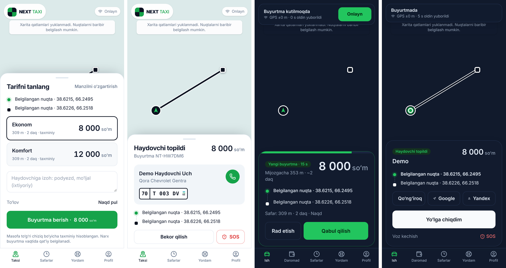

# NEXT TAXI

On-demand taxi booking platform. Pilot city: **G‘uzor, Qashqadaryo, Uzbekistan**. One codebase serves three apps: the passenger PWA, the driver PWA and the admin console. The UI is in Uzbek (Latin); currency is UZS.

> **Status: technical MVP (v0.1).** The core booking workflow works end to end on real PostgreSQL/PostGIS and passes automated unit, integration, concurrency and end-to-end tests. It is **not** legally approved or commercially launched. See [docs/pilot-readiness.md](docs/pilot-readiness.md) for the launch blockers and [docs/PROGRESS.md](docs/PROGRESS.md) for the progress report.

## What's inside

- **Passenger**: OTP login, map booking (GPS or tap), server-side fare quotes per class, idempotent booking, live search and driver tracking over SSE, rendered licence plate, call driver, cancel with reasons, SOS, cash payment summary, rating, history with timeline, support tickets.
- **Driver**: onboarding (profile, vehicle, document uploads incl. taxi licence) → compliance review, online/offline with eligibility gates, GPS reporting with wake lock, expiring offers with countdown, accept/reject, en-route → arrived (GPS-validated) → start → complete → cash confirmation, no-show after 3 min, navigation hand-off (Google/Yandex), earnings, commission debt, support.
- **Admin**: role-filtered console with overview KPIs, live map, ride history and detail (timeline, offers, ledger, interventions), verification queue, drivers, vehicles, passengers, cities and zone editor (draw or paste GeoJSON), versioned tariffs, finance (summary, driver balances, settlements, reconciliation), support, safety incidents, settings and staff roles, audit log.
- **Engines**: PostGIS dispatch with ETA ranking and expiring offers, a formal ride state machine with history, integer-UZS fare engine, double-entry append-only commission ledger, PostgreSQL-backed rate limiting, idempotency and realtime.

## Screenshots

Passenger (light) and driver ("night shift" dark) apps — tariff choice, driver assigned with the licence plate, expiring offer, active ride:



Admin console: [overview](docs/screenshots/admin-overview.png) · [live operations](docs/screenshots/admin-live.png) · public [landing page](docs/screenshots/landing.png). Screenshots were taken offline, so the map shows its plain fallback background instead of tiles.

## Stack

Next.js 15 (App Router) · React 19 · TypeScript (strict) · Tailwind CSS 4 · shadcn-style components (Radix + CVA) · Lucide · React Hook Form (support form; other forms use controlled state) · Zod · TanStack Query · Zustand · MapLibre GL · PostgreSQL 16 + PostGIS 3.4 · Prisma 6 (driver adapter, no native engines) · SSE + LISTEN/NOTIFY · Vitest · Playwright · Docker · GitHub Actions.

Architectural decisions and the reasons for them: [docs/architecture/overview.md](docs/architecture/overview.md).

## Quick start (local)

Requirements: Node 22+, PostgreSQL 15+ with PostGIS (or Docker).

```bash
npm ci
docker compose up -d db           # or use your own PostgreSQL + PostGIS
cp .env.example .env              # dev defaults work with the compose database
npm run db:migrate                # applies prisma/migrations (Prisma-compatible runner)
npm run db:seed:dev               # G‘uzor active 24h + demo accounts (DEV ONLY)
npm run dev                       # http://localhost:3000
```

Demo accounts (dev seed; the OTP code is shown on screen because `OTP_DEV_ECHO=true`):

| App | URL | Phone |
|---|---|---|
| Passenger | `/passenger` | 90 111 11 11 (or any number) |
| Driver (approved) | `/driver` | 90 222 22 21 / 22 / 23 |
| Admin (super admin) | `/admin` | 90 000 00 01 |

**Login codes via Telegram.** Set `OTP_CHANNEL=telegram` and `TELEGRAM_GATEWAY_TOKEN` (from the account settings at gateway.telegram.org). The code then arrives in the Telegram account of the entered number. Codes sent to the Gateway account owner's own number are free, which is handy for testing. Set `OTP_SMS_FALLBACK=true` to fall back to SMS for numbers without Telegram.

The default map tiles come from OpenFreeMap. Without internet access the map shows a plain background, and points can still be tapped.

## Scripts

| Command | What it does |
|---|---|
| `npm run dev` / `build` / `start` | Next.js dev server / production build / production server |
| `npm run typecheck` · `npm run lint` | `tsc --noEmit` · ESLint |
| `npm run db:migrate` | Apply migrations (writes `_prisma_migrations`, compatible with `prisma migrate deploy`) |
| `npm run db:seed` | Production-safe baseline (needs `SEED_ADMIN_PHONE` in production) |
| `npm run db:seed:dev` | Demo data (refuses to run in production) |
| `npm run db:reset` | Drop and re-migrate the dev database |
| `npm test` | Unit + integration tests against a real PostgreSQL test database (`nexttaxi_test`) |
| `npm run test:e2e` | HTTP end-to-end acceptance test: fresh DB, boots the **production build** with `APP_ENV=staging` |
| `npm run test:ui` | Playwright browser smoke tests (set `PLAYWRIGHT_BASE_URL`, optional `CHROME_PATH`) |
| `npm run worker` | Standalone dispatch worker (`DISPATCH_WORKER=external`) |
| `npm run maintenance:retention` | Data-retention purge (run daily) |

## Project layout

```
src/app/               pages (passenger/, driver/, admin/, legal/) and API route handlers (api/v1/)
src/features/          domain services: auth, pricing, zones, rides, dispatch, payments, drivers,
                       support, ratings, settings, admin, privacy, client (UI types)
src/lib/               db, env, auth (otp/session/sms), permissions, rate-limit, idempotency,
                       realtime (events/hub), maps (geo/routing/geocoding), storage, monitoring, logger
src/components/        ui/ (design system), maps/, layout/, admin/, shared/, auth/
prisma/                schema.prisma, migrations/ (generated + hand-written PostGIS/integrity SQL), seeds
scripts/               migrate, db-reset, dispatch-worker, retention
tests/                 unit/, integration/, e2e/run-e2e.ts, ui/ (Playwright)
docs/                  architecture/, api/, deployment/, compliance/, pilot-readiness.md, PROGRESS.md
```

## Documentation

- [Architecture](docs/architecture/overview.md) · [Realtime & GPS limits](docs/architecture/realtime-and-gps.md)
- [API reference](docs/api/README.md)
- [Deployment, backups, cost estimate](docs/deployment/README.md)
- [Security checklist](docs/compliance/security-checklist.md) · [Privacy & retention checklist](docs/compliance/privacy-retention-checklist.md)
- [Pilot readiness & launch blockers](docs/pilot-readiness.md) · [Progress report](docs/PROGRESS.md)
# next-taxi
