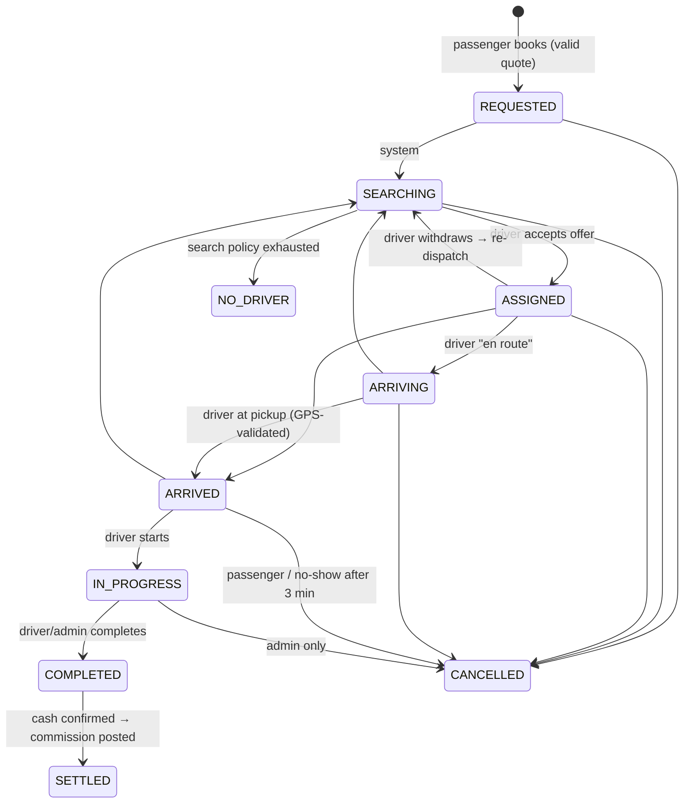

# NEXT TAXI — Technical architecture

## 1. Shape of the system

One deployable Next.js application (App Router) serving three role-specific clients and a versioned HTTP API, backed by a single PostgreSQL 16 + PostGIS 3 database. No microservices, no Redis, no Kubernetes: every coordination problem (locking, rate limiting, realtime fan-out, worker leader election) is solved inside PostgreSQL so the pilot runs on one small server.

```
 Passenger PWA ─┐                      ┌─────────────── Next.js (Node 22) ───────────────┐
 Driver PWA ────┼── HTTPS (cookies) ──▶│  Pages (RSC + client)   Route handlers /api/v1  │
 Admin web  ────┘   SSE /api/v1/events │  features/* services    Dispatch worker (tick)  │
                                       │  lib/* adapters: SMS · routing · geocoding ·    │
                                       │        storage · monitoring · realtime hub      │
                                       └───────────────┬───────────────────────┬─────────┘
                                                       │ SQL + LISTEN/NOTIFY   │ HTTP
                                         PostgreSQL 16 + PostGIS 3.4      OSRM · Eskiz · S3/R2
```

| Layer | Location | Responsibility |
|---|---|---|
| UI | `src/app/{passenger,driver,admin}` | Mobile-first PWA screens (Uzbek Latin), admin console |
| API | `src/app/api/v1/**/route.ts` | Thin handlers: auth, validation (Zod), call a service, serialise |
| Domain services | `src/features/*` | Business rules: pricing, rides, dispatch, payments, drivers, admin, support, privacy |
| Platform adapters | `src/lib/*` | DB client, auth/session/OTP, permissions, rate limiting, realtime, maps, storage, logging |
| Schema | `prisma/schema.prisma` + SQL migrations | 29 tables, PostGIS columns, constraints, triggers |

## 2. Key engineering decisions

| Decision | Why |
|---|---|
| **Prisma with the `pg` driver adapter and JS/WASM engines** (`engineType = "client"`) | No native engine download; works behind restrictive networks and on small hosts. |
| **Own migration runner** (`scripts/migrate.ts`) writing Prisma's `_prisma_migrations` format | The WASM migrate path failed on a catalog type. The runner is compatible: `prisma migrate deploy` can take over later. |
| **Hand-written SQL migration for PostGIS + integrity** | Prisma cannot express geography columns, partial unique indexes, CHECK constraints or triggers. |
| **SSE + PostgreSQL LISTEN/NOTIFY** instead of Supabase Realtime | Zero extra services or cost; events are published inside the DB transaction, so clients never see rolled-back state. Supabase can replace the adapter later. |
| **Dispatch worker inside the web process** with an advisory-lock leader | One server is enough for a pilot; `DISPATCH_WORKER=external` or the cron endpoint scale it out. |
| **shadcn/ui pattern, hand-written** (`src/components/ui`) | The shadcn CLI needs registry access; the components follow the same Radix + CVA + Tailwind approach. |
| **System font stack** | No web-font download on low-end Android phones; tabular numerals for prices. |
| **Upfront pricing** (final fare = accepted quote) | Predictable for passengers, simple to audit. Metered fares are a later decision. |

## 3. Ride lifecycle (formal state machine)

`src/features/rides/state-machine.ts` defines allowed transitions **and which actor may perform each one**. Every change goes through `applyTransition()`, which:
1. checks the state machine,
2. updates with `WHERE status = $from AND version = $version` (optimistic guard) while holding a `SELECT … FOR UPDATE` row lock,
3. appends to `ride_status_events` (append-only; UPDATE/DELETE blocked by trigger),
4. publishes a realtime event that is delivered only on commit.



Database guarantees that hold even if application code is wrong:
- `rides_one_active_per_passenger` — partial unique index: one open ride per passenger.
- `rides_one_active_per_driver` — one assigned/active ride per driver.
- `ride_offers_one_pending_per_driver` — a driver sees one offer at a time; `UNIQUE(ride_id, driver_id)` — never offered the same ride twice.
- `fare_quotes` row lock + `rides.quote_id UNIQUE` — a quote books at most one ride.
- CHECK constraints: driver required once assigned; fare/commission present once completed; payment `driver_earnings = amount − commission`.

## 4. Dispatch algorithm (`src/features/dispatch/service.ts`)

1. Ride enters `SEARCHING` → `dispatchRide()` runs right after the booking commits (and every tick).
2. **Candidates** (one SQL query, GiST index on `driver_locations.geog`): approved driver, active account, `ONLINE`, same city, approved active vehicle of the requested class, GPS fix < 60 s old, `ST_DWithin(pickup, radius)`, no active/unsettled ride, no pending offer, never offered this ride, commission debt ≤ city limit. Ordered by `ST_Distance`.
3. **Ranking**: road ETA from the routing provider (OSRM table service) for up to 3× the open slots; distance as tie-breaker; straight-line fallback if routing is down.
4. **Offer**: inside a transaction holding the ride lock, insert `ride_offers` (PENDING, `expires_at = now + offerTimeoutSeconds`), notify the driver. `offerBatchSize` (1–5) controls sequential vs. broadcast dispatch.
5. **Accept**: lock order is always **ride → offer** (same as cancellation) to avoid deadlocks. Checks offer pending and unexpired, ride still SEARCHING, driver still eligible; assigns, marks the offer ACCEPTED, cancels sibling offers. Concurrent accepts: exactly one wins (tested).
6. **Reject/expire** → next candidate. Expiry is processed by the tick and also enforced at accept time.
7. **NO_DRIVER** when `maxOffersPerRide` offers were made or `searchTimeoutSeconds` elapsed with no pending offer.
8. The tick also switches drivers offline after 10 min without GPS (closed app), so the pool stays truthful.

## 5. Pricing (`src/features/pricing`)

`Fare = Base + perKm × km + perMinute × min`, raised to `minimumFare`, rounded **up** to `roundingStep`. All integer so‘m; half-up integer division; no floats in money. Tariffs are **versioned**: publishing creates version N+1 and retires the active one (partial unique index allows one active per city + class). Quotes store the tariff version, route figures, breakdown, commission rate and expiry; a ride books the quote's locked price. The client never sends a price — the API ignores it (tested in e2e).

## 6. Money model (`src/features/payments`)

Cash only in v0.1. The passenger pays the driver; the platform receives nothing at that moment. On cash confirmation:

| Event | Debit | Credit |
|---|---|---|
| `COMMISSION_ACCRUED` (per ride) | DRIVER_COMMISSION_RECEIVABLE | PLATFORM_COMMISSION_REVENUE |
| `COMMISSION_SETTLED` (finance records driver payment) | PLATFORM_CASH | DRIVER_COMMISSION_RECEIVABLE |

- `ledger_entries` is append-only (trigger) and every transaction must balance (deferred constraint trigger checks Σdebit = Σcredit at commit).
- One accrual per ride (partial unique index). Settlements lock the driver row and cannot exceed the outstanding balance.
- `reconcile()` cross-checks rides ↔ payments ↔ ledger; shown on the finance page.
- `payments.status = COLLECTED_BY_DRIVER` is the driver's statement, **not** proof the platform received money.
- Click/Payme: add a `PaymentProvider` adapter writing `payments.provider_ref`; nothing is connected today.

## 7. Realtime

See [realtime-and-gps.md](realtime-and-gps.md).

## 8. Security model (summary)

- Phone + OTP (HMAC-hashed codes, 5 attempts, atomic attempt counting, single use, per-phone/IP rate limits).
- Opaque session tokens (SHA-256 at rest), httpOnly + SameSite=Lax cookies, separate cookie per app, 30-day (end users) / 12-hour (staff) expiry, revocation on block/role change.
- Server-side RBAC matrix (`src/lib/permissions`) checked in every admin route and page; city scoping for city managers.
- Same-origin check on mutating requests; strict CSP and security headers; Zod validation everywhere; magic-byte upload sniffing; private storage with path-traversal protection; audited document views.
- Phone numbers/locations exposed only to the counterpart of an **active** ride; staff lists mask phones.

Full checklist: [../compliance/security-checklist.md](../compliance/security-checklist.md).

## 9. Provider adapters

| Concern | Interface | Implementations | Production status |
|---|---|---|---|
| SMS | `SmsProvider` | `ConsoleSmsProvider` (dev), `EskizSmsProvider` | Eskiz adapter written, **not verified** without credentials |
| Routing | `RoutingProvider` | `EstimatedRoutingProvider` (dev), `OsrmRoutingProvider` | Needs a self-hosted OSRM (Uzbekistan extract) |
| Geocoding | `GeocodingProvider` | `NoGeocodingProvider`, `NominatimGeocodingProvider` | Optional; map-pin booking works without it |
| Storage | `StorageProvider` | `LocalStorageProvider`, `S3StorageProvider` (aws4fetch) | Local tested; S3/R2 **not verified** |
| Map tiles | style URL env | OpenFreeMap (default), any MapLibre style | Verify availability/terms before launch |
| Monitoring | `reportError()` | structured logs + optional webhook | Sentry can be added |
| Payments | — | cash only | Click/Payme not integrated |
